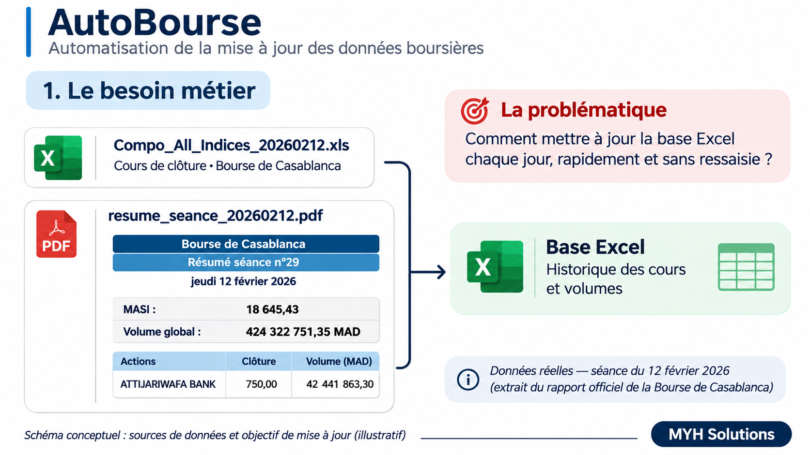
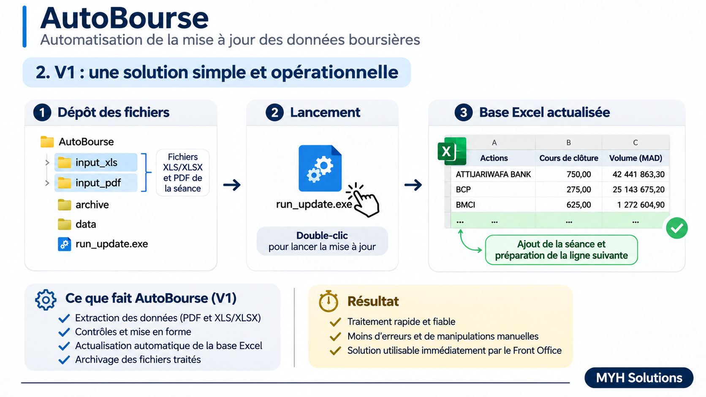
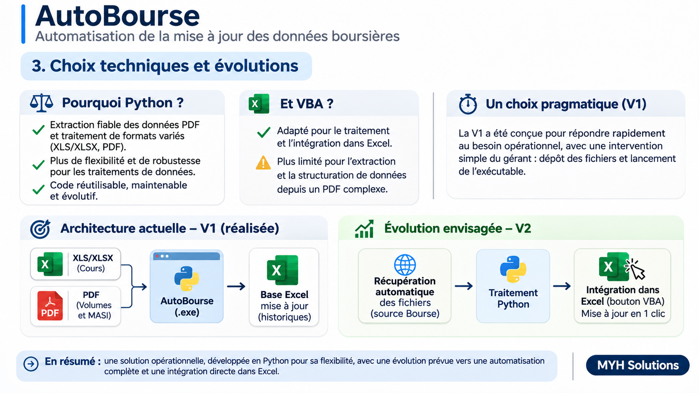

# AutoBourse

**Automatisation de la mise à jour des données boursières avec Python**

Projet réalisé par **Yassine Hammouti** pendant mon stage de fin d'études chez **IRG Asset Management**, à Casablanca.

> **Une tâche Front Office concrète :** alimenter chaque jour un historique Excel de cours et de volumes à partir de deux fichiers de marché, sans ressaisie manuelle.

## Le besoin métier

Après chaque séance de la **Bourse de Casablanca**, les informations nécessaires à la mise à jour de la base Excel proviennent de deux canaux différents :

| Source | Réception | Données utilisées |
|---|---|---|
| **XLS** (format historique) / **XLSX** (format ajouté ensuite) | Fichier Excel reçu par e-mail par les gérants du Front Office | Cours de clôture |
| **PDF — résumé de séance** | Rapport disponible sur le site de la Bourse de Casablanca | Volumes échangés et indice MASI |

L'objectif était de **réduire le travail répétitif**, conserver l'historique existant et rendre la mise à jour accessible à un utilisateur qui ne programme pas.

## V1 — La solution réalisée

Le principe est volontairement simple :

1. Le gérant télécharge le **PDF** et récupère le **XLS** reçu par e-mail.
2. Il dépose les deux fichiers dans les dossiers d'entrée.
3. Il lance le programme Python empaqueté en **exécutable Windows** (`.exe`) par un double-clic.
4. AutoBourse extrait les données, contrôle la cohérence de la séance, actualise la base Excel et archive les fichiers traités.

### Pourquoi Python plutôt que seulement VBA ?

VBA restait pertinent pour travailler *dans* Excel. **Python** a été retenu pour faciliter l'extraction de données PDF, le traitement de plusieurs formats, la séparation des étapes et la maintenance. Il ne s'agissait pas d'une impossibilité technique de VBA, mais d'un **choix pragmatique** compte tenu des besoins et du temps disponible.

**Bibliothèques :** Python, `openpyxl`, `xlrd`, `pdfplumber`.

### Pourquoi une intervention manuelle en V1 ?

La priorité était de **livrer rapidement un outil utilisable**. Automatiser aussi la récupération des sources demandait des développements et des autorisations supplémentaires. Le dépôt des fichiers est resté manuel afin de concentrer la première version sur le traitement et la mise à jour fiable du classeur.

## V2 — Évolutions envisagées (non livrées)

- **E-mail Front Office :** récupération automatique des pièces jointes XLS/XLSX, par exemple via **Microsoft Graph** *si la messagerie et les autorisations de l'organisation le permettent*.
- **Site de la Bourse :** récupération automatique du PDF de séance, sous réserve de vérifier les modalités d'accès et les droits d'utilisation.
- **Excel :** lancement du traitement Python depuis un bouton dans le classeur (par exemple, avec VBA), sans manipulation des dossiers.

**À distinguer :** la V1 a été réalisée pendant le stage. La V2 décrit une direction possible, pas une fonctionnalité déjà livrée. Le support du **XLSX** a été développé ensuite ; sa compatibilité avec les exports XLSX natifs les plus récents reste à confirmer.

## Exemple réel : séance du 12 février 2026

Le projet a notamment été travaillé avec le fichier `Compo_All_Indices_20260212.xls` et le rapport `resume_seance_20260212.pdf` de la Bourse de Casablanca.

Le résumé de séance du **12 février 2026** indique notamment :

- **MASI : 18 645,43**
- **Volume global : 424 322 751,35 MAD**
- **Attijariwafa Bank :** cours de clôture de **750,00 MAD**, volume de **42 441 863,30 MAD**

Ces chiffres sont cités comme **exemples issus des documents de marché**, et non comme des performances ou des gains de productivité mesurés du programme.

## Accès au code

Le **code source reste dans un dépôt GitHub privé**. Pour le consulter, vous pouvez demander un accès via le formulaire :

### [Demander l'accès au code AutoBourse](https://airtable.com/appW5VgoUmJpwzzMj/pagd8IJ8RE2MSwNNc/form)

Chaque demande est examinée individuellement ; remplir le formulaire n'accorde pas un accès automatique au dépôt.

---

*Yassine Hammouti — M2 Gestion des Actifs, Université Paris Nanterre*  
*Ce dépôt présente le projet ; il ne contient ni code source ni fichiers opérationnels.*
